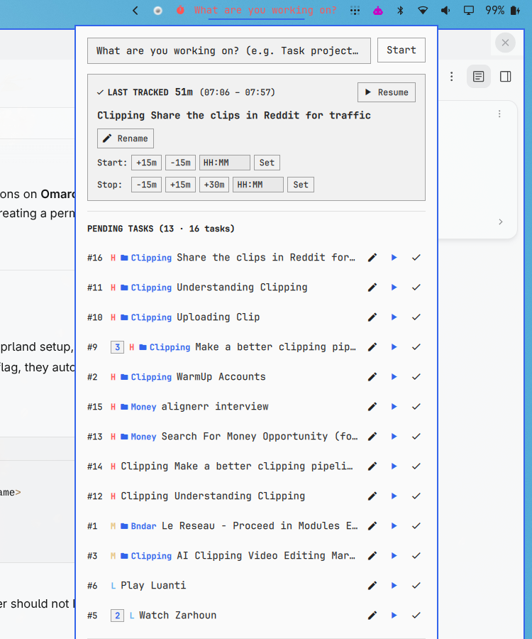

# Omarchy Taskwarrior Plugin (`omarchy-taskwarrior`)

A Toggl Desktop-style time tracking and task management bar widget & popup panel for the [Omarchy](https://github.com/omarchy/omarchy) shell, powered by **Taskwarrior** and **Timewarrior**.



---

## ✨ Features

- **Toggl-Style Status Bar Widget**:
  - **Active Tracking**: Displays the running task name, elapsed time (`HH:MM:SS`), project, and priority.
  - **Idle State**: Displays an alert prompt (*"What are you working on?"*) in red when no task is active, with configurable periodic desktop notifications.
- **Smart Quick Start**:
  - Type any task description in the popup input to start immediately.
  - Auto-detects projects and priorities (e.g. `Uploading video project:Clipping priority:H` or `Clipping Uploading video`).
- **Toggl-Style Project-Task Gathering**:
  - Tasks sharing the same project and description are consolidated into a single clean row with a count badge (e.g. `[ 3 ]`).
  - Perform batch actions: Start, complete all instances (`Done (3)`), or delete all (`Delete (3)`).
- **Time Adjustments**:
  - **Adjust Start Time**: Offset start time with quick buttons (`+15m`, `-15m`, `+30m`) or exact `HH:MM`.
  - **Retroactive Stop**: Stop at past times (`-15m`, `-30m`) or exact `HH:MM`.
- **Islamic Prayer Times (Adhan) Auto-Stop**:
  - Automatically stops tracking when prayer times arrive (Fajr, Dhuhr, Asr, Maghrib, Isha) so you never accidentally track while praying.
  - Next prayer indicator and countdown displayed directly in the panel.
- **Accurate Day Tallying**:
  - Automatically bounds time tracking strictly to the current day (`00:00:00` onwards), preventing overnight intervals from polluting the next day's total.

---

## 📦 Installation

Install directly using the Omarchy plugin CLI:

```bash
omarchy plugin add https://github.com/EmbeddedMhawar/omarchy-taskwarrior.git --enable
```

Or clone manually into your Omarchy plugins directory:

```bash
git clone https://github.com/EmbeddedMhawar/omarchy-taskwarrior.git ~/.config/omarchy/plugins/mhawar.taskwarrior
omarchy restart shell
```

---

## 🛠️ Prerequisites

Ensure Taskwarrior and Timewarrior are installed on your system:

```bash
# Arch Linux
sudo pacman -S task timew jq python
```

---

## ⚙️ Configuration

Configure widget options in `~/.config/omarchy/shell.json` or through the plugin manifest defaults:

| Option | Type | Default | Description |
| :--- | :--- | :--- | :--- |
| `idlePrompt` | `string` | `"What are you working on?"` | Text shown in the bar when idle |
| `idleColor` | `string` | `"#ff5555"` | Color of the idle prompt |
| `idleReminderMinutes` | `integer` | `15` | Minutes between idle reminders |
| `autoStopAdhan` | `boolean` | `true` | Auto-stop active timers at Adhan |

---

## 📄 License

MIT © [Abderrahmane Mhawar](https://github.com/EmbeddedMhawar)
